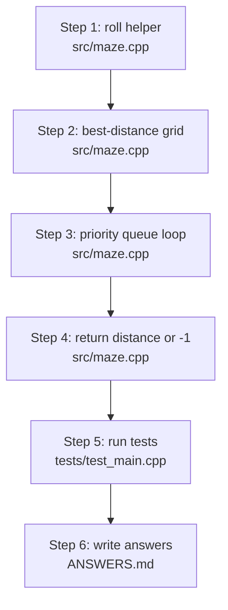
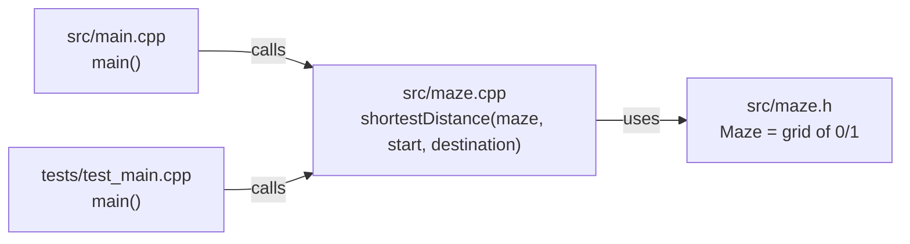
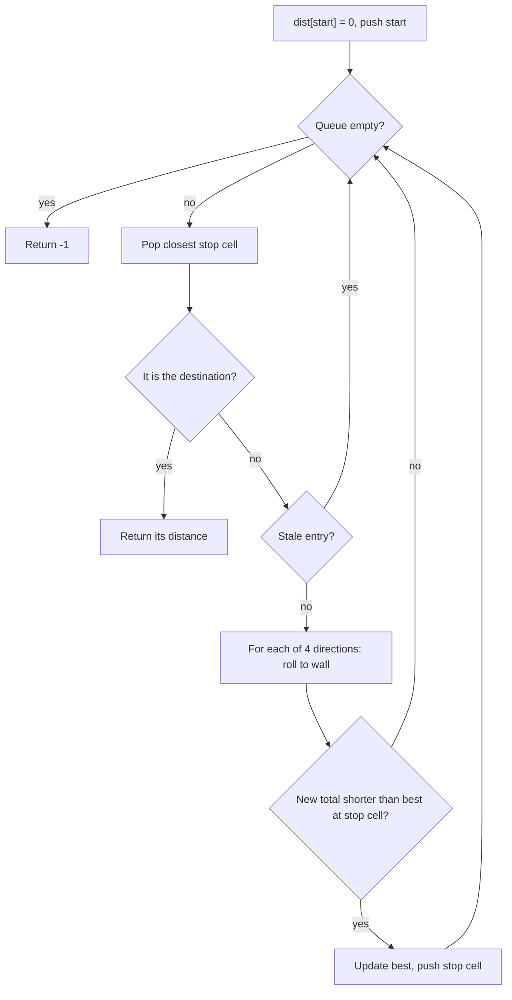
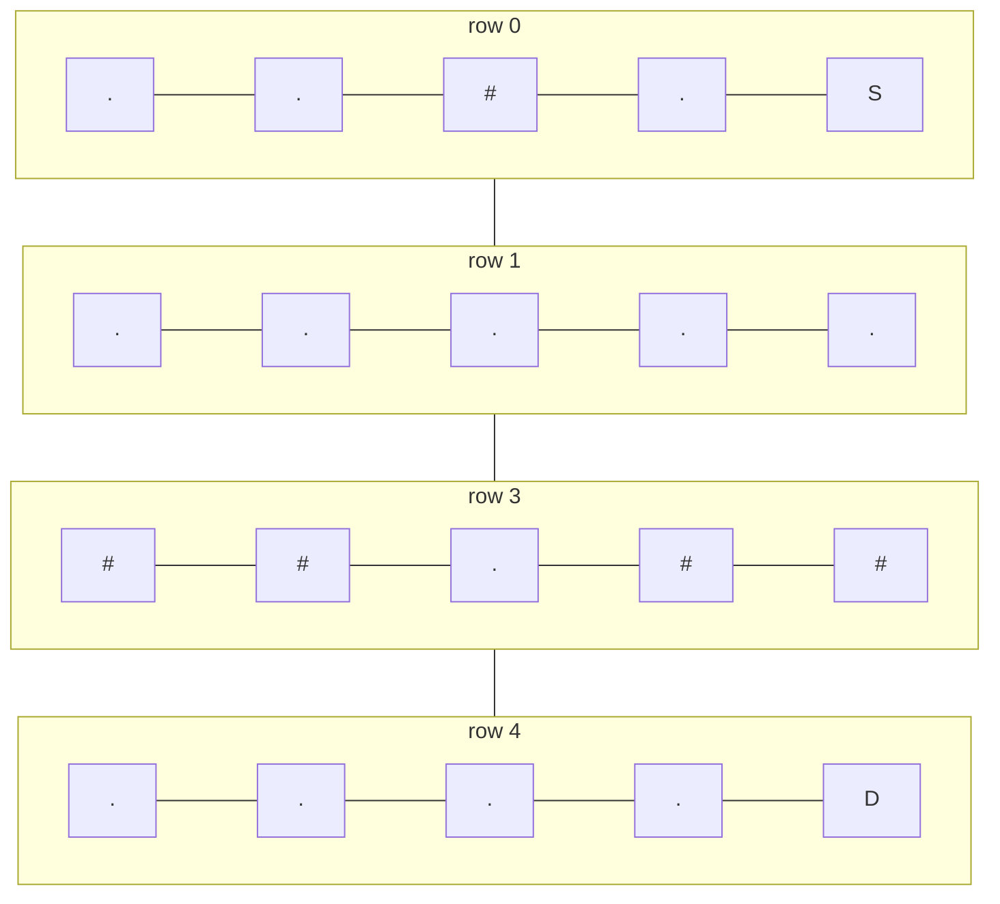
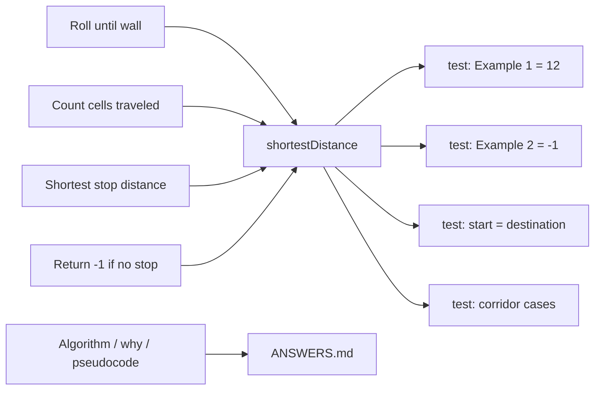

# Ball Maze Shortest Distance — Diagrams
See [OUTLINE.md](OUTLINE.md)

## Plan

Build order from the roll helper to the write-up.

## Code structure

Files and the one function they share. Add the roll helper inside `src/maze.cpp`.

## Program flow

What `shortestDistance` does at runtime.

## Maze (Example 1)

Rows 0, 1, 3, 4 of the maze (row 2 is `. . . # .`). S = start [0,4], D = destination [4,4], # = wall. Row 3 has one gap at column 2.

## Requirements → code

Each requirement, the function that meets it, and the tests.
