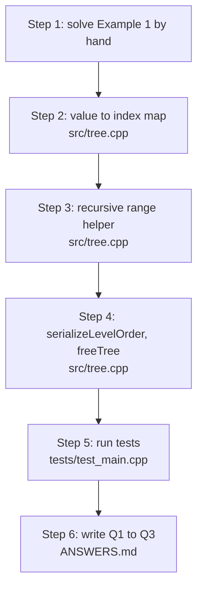
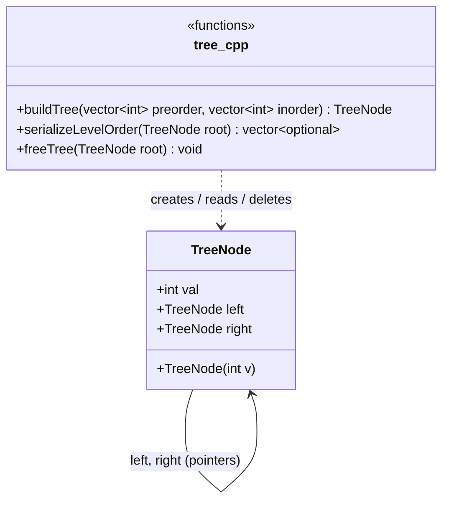
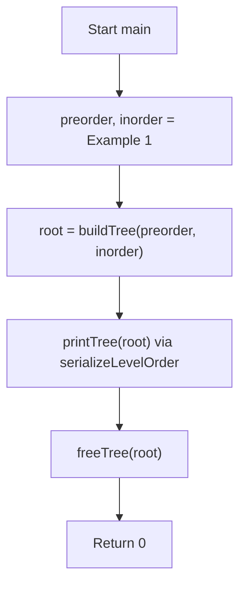
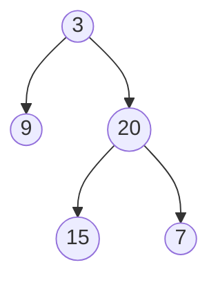
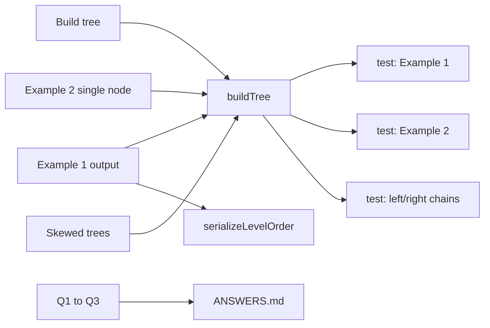

# Construct Binary Tree — Diagrams
See [OUTLINE.md](OUTLINE.md)

## Plan

Build order from hand-worked example to written answers.

## Code structure

The node struct and the free functions in `src/tree.cpp`. Fields and returns marked TreeNode are pointers (`TreeNode*`) in the code.

## Program flow

What `main` does when run.

## Tree shape (Example 1)

Preorder [3,9,20,15,7] starts with root 3. In inorder [9,3,15,20,7], 9 is left of 3 and 15,20,7 are right.

## Requirements → code

Each requirement, the code that meets it, and its test.
