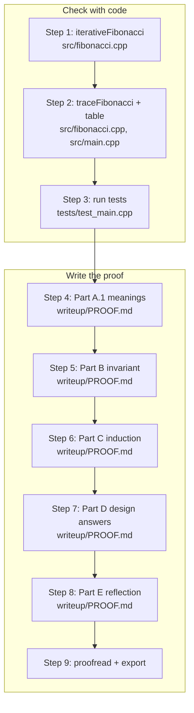
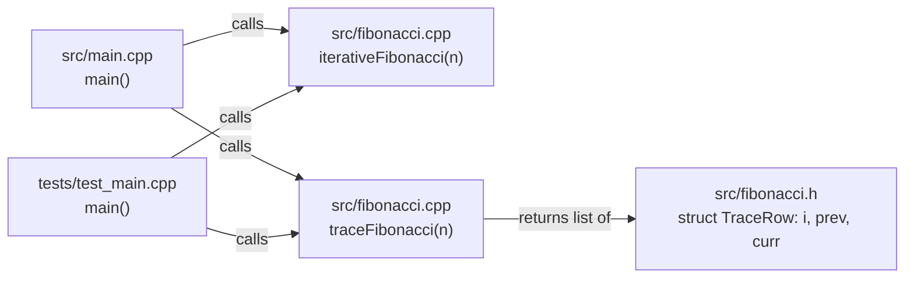
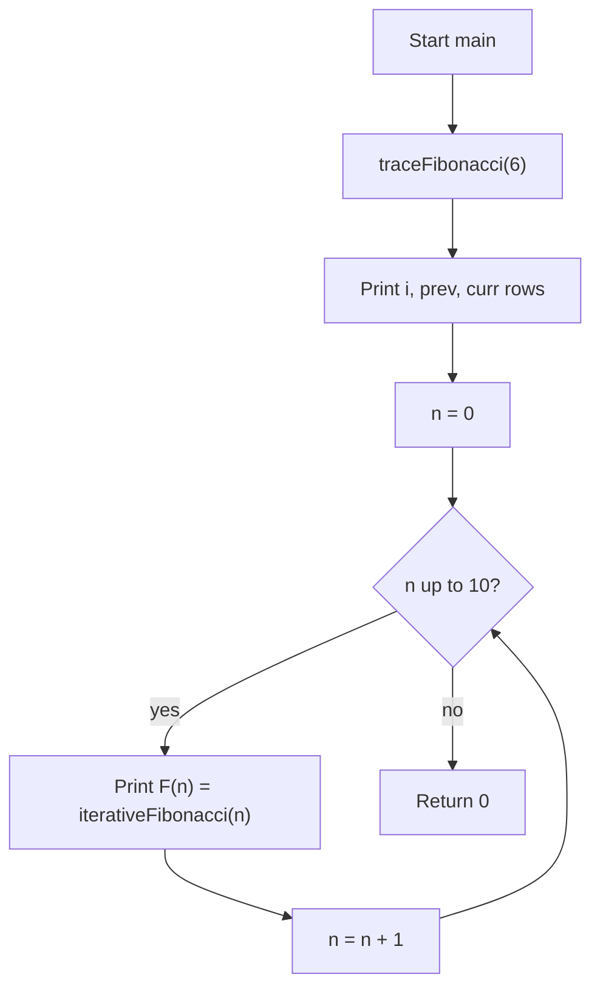
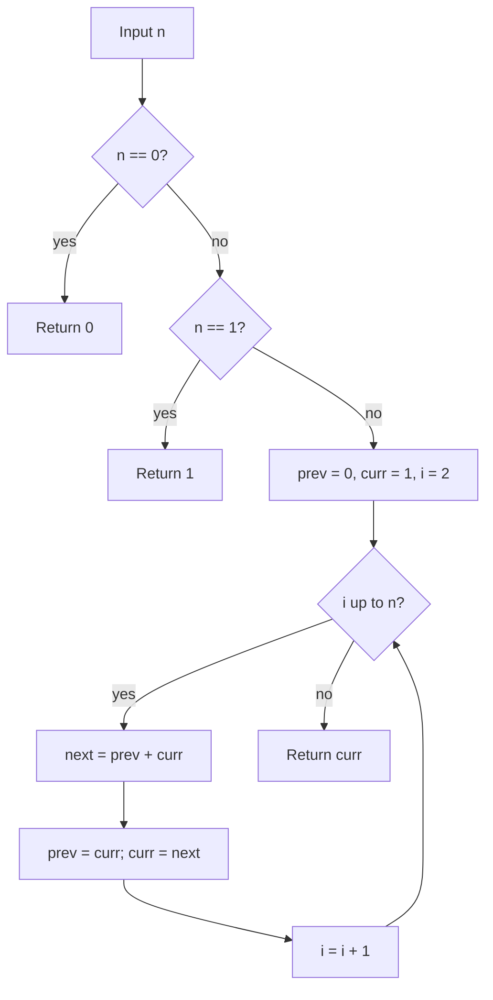
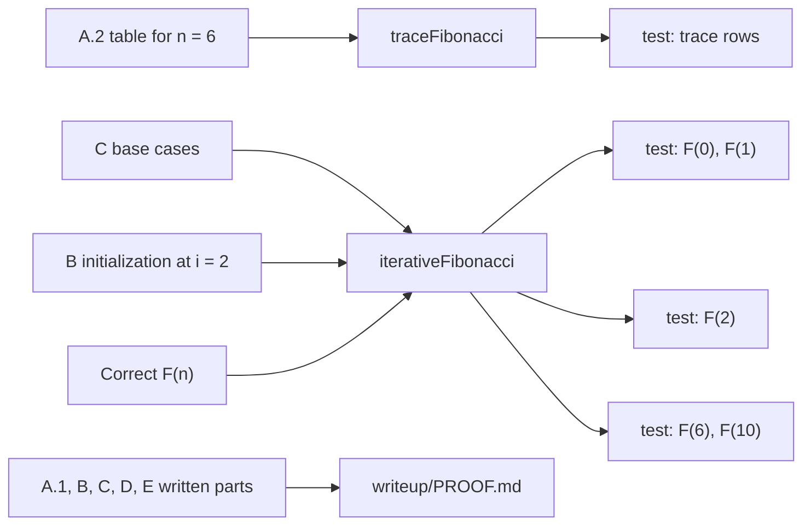

# Fibonacci Correctness Proof — Diagrams
See [OUTLINE.md](OUTLINE.md)

## Plan

The build order: get the code checking your table first, then write each proof part.

## Code structure

Which file holds which function, and who calls what.

## Program flow

What the helper program does when run: print the table, then F(0) to F(10).

## Algorithm state (the loop)

The algorithm under study. Your invariant is a claim about prev and curr each time the flow reaches the "i up to n?" check.

## Requirements → code

Each requirement, the code or file that covers it, and the test that checks it. The written parts have no test; only you can check them.
