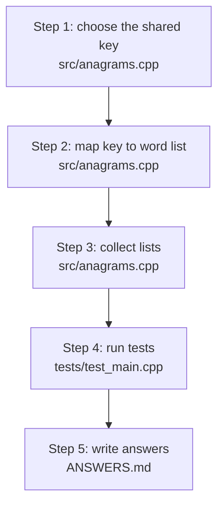
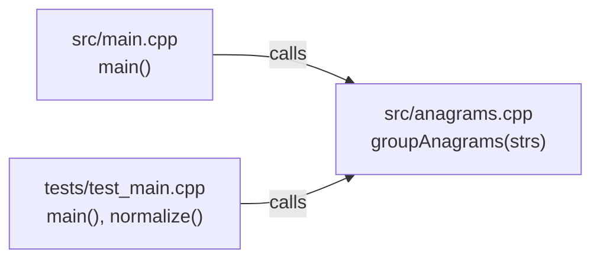
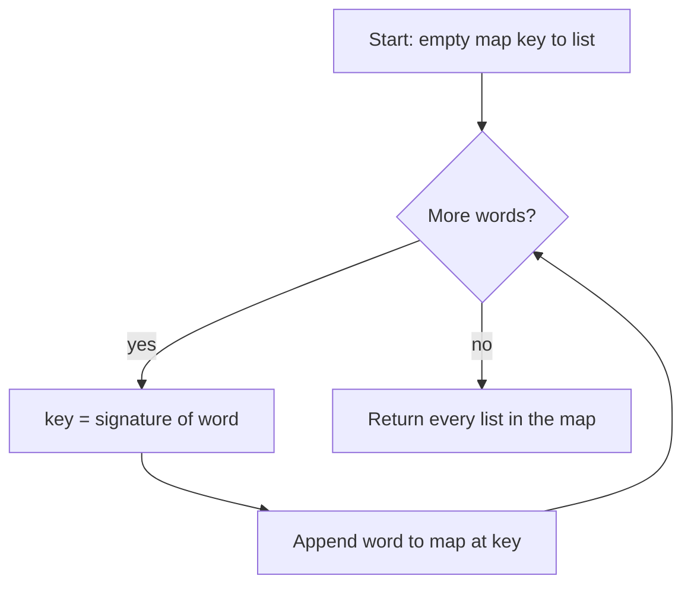
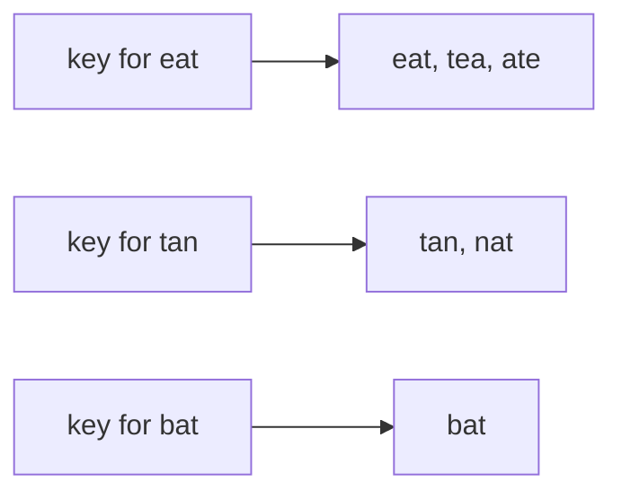
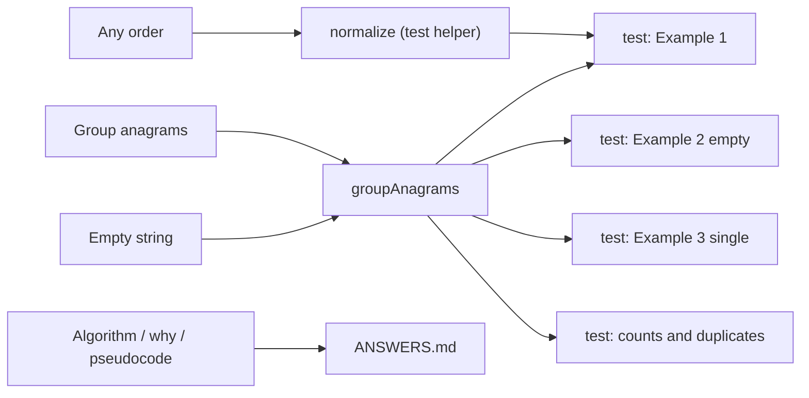

# Group Anagrams — Diagrams
See [OUTLINE.md](OUTLINE.md)

## Plan

Build order from key choice to the write-up.

## Code structure

Files and the one function they share.

## Program flow

What `groupAnagrams` does at runtime.

## Map shape (Example 1)

Each key points to its group; the result is the three lists on the right.

## Requirements → code

Each requirement, the code that meets it, and the tests.
