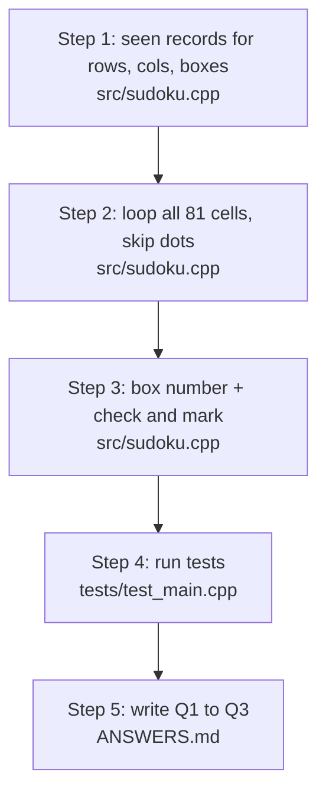
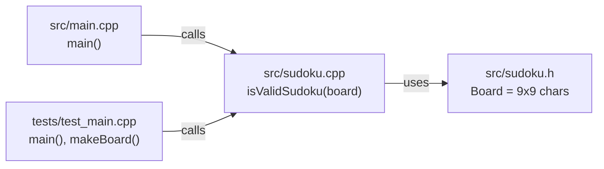
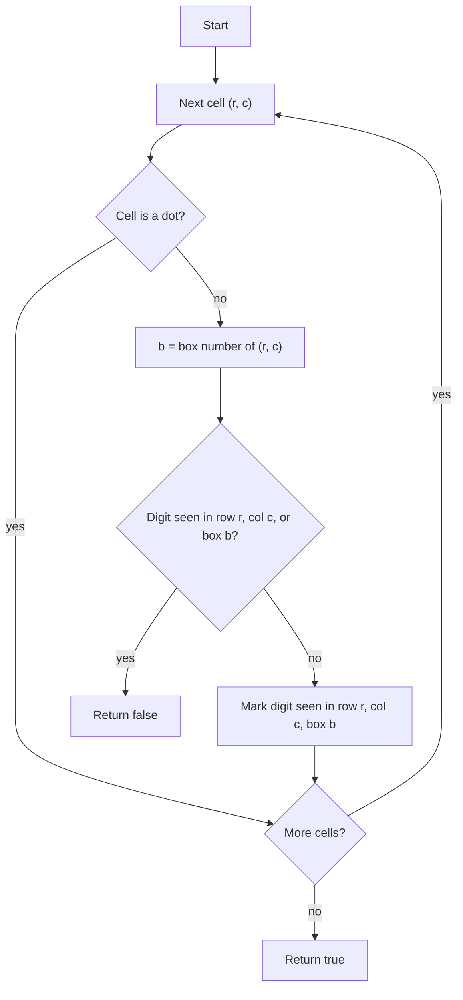
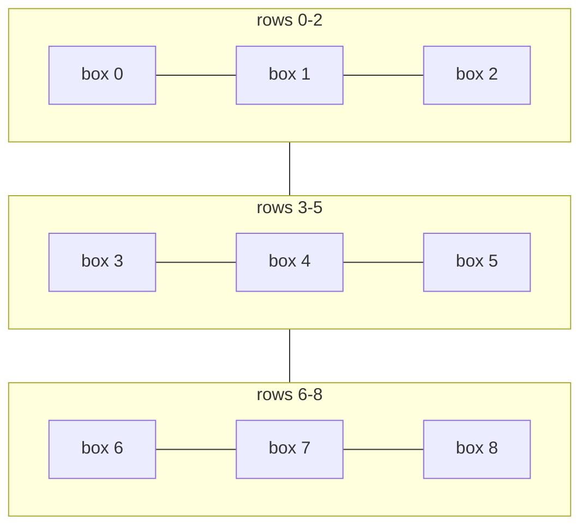
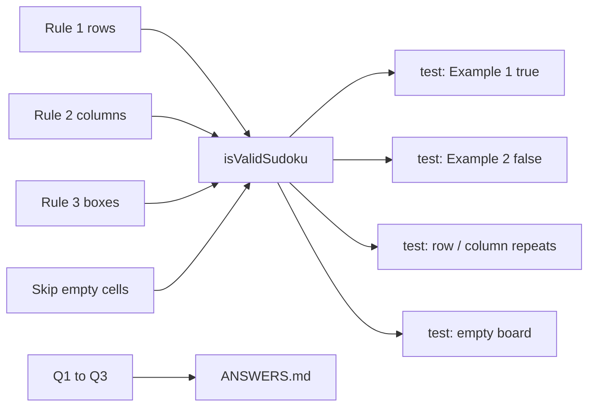

# Valid Sudoku — Diagrams
See [OUTLINE.md](OUTLINE.md)

## Plan

Build order from data setup to written answers.

## Code structure

Files and the one function they share.

## Program flow

What `isValidSudoku` does at runtime.

## Box layout

How the nine boxes are numbered; columns 0-2, 3-5, 6-8 go left to right.

## Requirements → code

Each rule, the function that checks it, and the tests.
